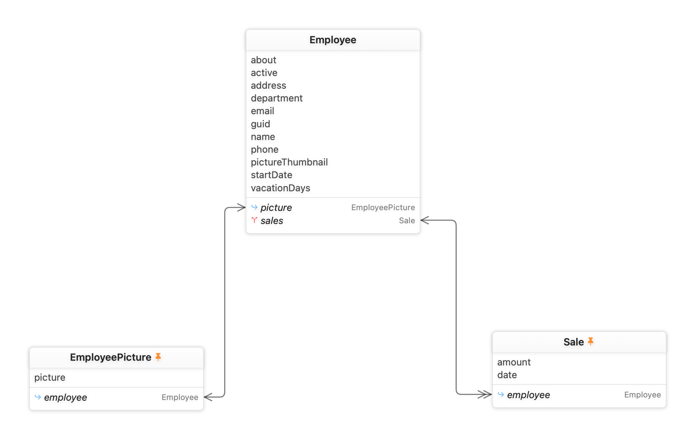

# CoreDataGraph

> 一个用 SwiftUI 编写的 macOS 应用 —— 可视化任意 Core Data 模型的实体关系图（ER Graph），补回新版 Xcode 移除的 Data Model Graph Editor。

  

---

## 为什么做这个

新版 Xcode 打开 `.xcdatamodeld` 时不再显示实体关系图，只能逐个点 Entity 查看 Relationship。CoreDataGraph 直接解析模型文件，把完整的关系图画出来，并且比旧 Xcode 更强大：**版本 Diff、自定义排版记忆、导出 PNG/Mermaid/DOT、自动刷新**。

## 功能一览

### 📂 通用模型加载
- 支持打开 **任意** Core Data 模型：`.xcdatamodeld`（含多版本）、`.xcdatamodel`、`contents` XML、编译产物 `.mom` / `.momd`
- 打开方式：⌘O 文件面板 / 拖拽进窗口 / 最近打开列表（安全作用域书签持久化）/ **Finder 双击 / 右键“打开方式” / `open -a`**（已注册文档类型）
- 多窗口支持：可同时打开多个模型对比查看
- **自动刷新**：监听模型文件，在 Xcode 里保存后画布自动更新（并保留你手动调整的布局）

### 🎨 Xcode 风格关系图
- 实体卡片：标题栏 + 属性区 + 关系区，样式复刻旧 Xcode Graph Editor
- 连线：**横平竖直的正交折线**（圆角拐弯），从卡片的具体"关系行"上引出
- 一对关系（relationship + inverse）合并为**一条线**，两端分别标注关系名 / inverse 名
- 基数可视化：to-one 单箭头、to-many 双箭头（箭头样式可配置：空心/实心/鸦爪/线条/无）
- 点击实体 → 只高亮直接关联，其余变淡；关系行可点击跳转到目标实体

### 🧭 布局
| 布局 | 说明 |
|---|---|
| 自定义 | **记忆你拖动过的每张卡片位置**（按模型+版本持久化），下次打开自动恢复 |
| 原始排版 | 还原模型 XML `<elements>` 中保存的旧 Xcode 排版坐标 |
| 力导向 | 层级种子 + 弹簧力 + **矩形碰撞分离**，相关实体聚簇、卡片永不重叠 |
| 层级 | 拓扑分层 + 重心排序 + 层内自动换行（横向不会拉得过长）|

### 🖱 画布交互
| 操作 | 行为 |
|---|---|
| 空白处拖动 | **框选**多张卡片成组 |
| 拖动组内任意卡片 | 整组移动（松手自动保存排版）|
| Shift + 点击卡片 | 加入/移出多选组 |
| 双指滚动 | 平移画布（方向可在设置中反转）|
| ⌥Option + 拖动空白 | 平移画布 |
| 捏合 | 缩放（卡片、连线、标签整图等比缩放，任何缩放级别下不重叠）|
| 双击卡片 | 展开 / 折叠完整属性 |
| 双击左边栏实体 | **Fly-to 聚焦**：平滑飞行居中 + 自动放大 |
| ⌘Z / ⇧⌘Z | **撤销 / 重做**卡片位置调整与重新布局 |
| ⌘0 | 缩放适配全部内容 |
| ⇧⌘L | 重新布局 |
| 右键卡片 | 折叠/固定/复制名称/高亮关联 |

### 🔬 版本 Diff（Xcode 从来没有的能力）
- 工具栏 Compare 弹出面板：**任意选择两个版本**对比（不限于“历史 → 当前”）
- 画布着色：🟢 新增实体、🔴 删除实体（幽灵卡片 **含其红色关系连线**）、🟠 修改实体
- **行级着色**：变更实体的卡片上，新增属性/关系标绿点、修改标橙、被删除的关系显示为红色删除线行
- Inspector 列出属性/关系级别的完整变更明细（类型变化、Optional 变化、删除规则变化、inverse 变化…）
- 检查 lightweight migration 是否遗漏的利器

### 📤 导出
- **PNG**（2x 分辨率快照）
- **Mermaid** `erDiagram`（可直接贴进 Markdown / GitHub / 语雀）
- **Graphviz DOT**（record 节点 + 基数箭头，可 `dot -Tsvg` 二次处理）

### ⚙️ 设置（⌘,）
- 卡片字体大小（80%–160%，卡片尺寸自动重算 + 防重叠）
- 卡片是否显示属性类型
- 连线粗细（0.5–4.0pt）
- 箭头样式：`空心(Xcode)` / `实心` / `鸦爪` / `线条(→/⇒)` / `无`，带 1:1 / 1:N 实时预览
- 连线关系名标签显隐
- 卡片选中颜色 / 连线选中颜色（ColorPicker）
- 滚动平移方向：自然 / 反向

## 环境要求

- macOS 14+（工程默认 Deployment Target 为 macOS 26.2，可自行调低）
- Xcode 16+（工程使用 FileSystemSynchronized Groups）
- **零第三方依赖**

## 构建运行

```bash
cd CoreDataGraph
xcodebuild -project CoreDataGraph.xcodeproj -scheme CoreDataGraph -configuration Debug build
open ~/Library/Developer/Xcode/DerivedData/CoreDataGraph-*/Build/Products/Debug/CoreDataGraph.app
```

或直接用 Xcode 打开 `CoreDataGraph.xcodeproj` 后 ⌘R。

> 沙盒说明：App 使用 `readwrite` 的 User Selected Files 权限（导出 PNG/文本需要保存面板）。

## 项目结构

```
CoreDataGraph/
├── CoreDataGraphApp.swift          # App 入口、菜单命令、Settings scene
├── ContentView.swift               # 三栏布局骨架 + 工具栏 + 文件导入/拖拽
├── Model/
│   ├── GraphModel.swift            # EntityNode / RelationshipEdge / NodeMetrics 等值类型
│   ├── ContentsXMLParser.swift     # 解析 contents XML（含 <elements> 排版坐标）
│   ├── ModelLoader.swift           # xcdatamodeld/xcdatamodel/contents/mom 统一加载入口
│   └── ModelDiffer.swift           # 版本 Diff（实体/属性/关系级）
├── ViewModel/
│   ├── GraphViewModel.swift        # @Observable 核心状态：图数据/选中/框选/缩放平移/Diff/文件监听
│   └── LayoutEngine.swift          # 原始排版 / 力导向(矩形碰撞) / 层级(自动换行)
├── Views/
│   ├── GraphCanvasView.swift       # 画布：Canvas 连线层 + 卡片层 + 手势(框选/拖动/缩放/滚动平移)
│   ├── GraphDrawing.swift          # 连线绘制：正交路由/行级锚点/箭头样式/标签
│   ├── EntityNodeView.swift        # Xcode 风格实体卡片
│   ├── SidebarView.swift           # 左栏：版本切换/搜索/实体列表/Diff 摘要
│   ├── InspectorView.swift         # 右栏：实体详情/Diff 详情/模型概览
│   ├── WelcomeView.swift           # 欢迎页 + 最近打开
│   └── SettingsView.swift          # 设置窗口
└── Helpers/
    ├── AppSettings.swift           # 用户偏好（@Observable + UserDefaults）
    ├── Exporter.swift              # PNG / Mermaid / DOT 导出
    ├── PositionStore.swift         # 自定义排版持久化
    ├── RecentFilesStore.swift      # 最近文件（安全作用域书签）
    ├── OpenRouter.swift            # Finder/AppleEvent 打开请求路由到活动窗口
    └── DirectoryWatcher.swift      # GCD 文件监听（自动刷新）

SupportingFiles/Info.plist          # 文档类型注册（CFBundleDocumentTypes + UTImportedTypeDeclarations）
```

## 技术要点

- **渲染架构**：连线用 `Canvas` 一次性绘制（世界坐标 + `ctx.scaleBy` 缩放），卡片用 SwiftUI View 叠加并 `.scaleEffect(zoom)`——整图等比缩放，卡片间相对距离恒定，任意缩放级别不重叠
- **正交路由**：连线从卡片关系行的左右边缘引出，Z 字形走线 + 圆角；同侧多条线自动分槽
- **布局算法**：力导向 = 层级 BFS 种子 + 弹簧引力 + **矩形分离约束** + 确定性碰撞扫除（数学保证 0 重叠）；80 节点布局 < 10ms
- **模型解析**：直接解析 `contents` XML（可拿到 Transformable 类名、valueTransformer、fetchIndex、唯一约束、排版坐标等 `NSManagedObjectModel` 拿不全的信息）；`.mom` 走 `NSManagedObjectModel(contentsOf:)` 兜底
- **持久化**：自定义排版 / 最近文件（security-scoped bookmark）/ 全部设置项，均基于 UserDefaults

## Roadmap / Ideas

- [ ] 继承关系（parentEntity）用空心三角箭头单独表达
- [ ] 大模型性能优化（Barnes-Hut 近似 / minimap）
- [ ] 布局 JSON 导入/导出，团队共享排版
- [ ] 导出 SVG
- [ ] 单元测试 target
- [ ] 本地化（en）

## License

个人学习项目，随意使用。
